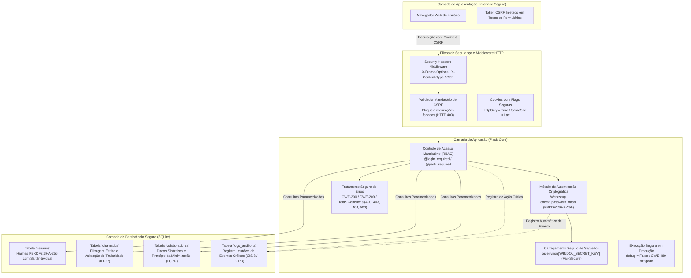

# Arquitetura do Sistema Atualizado (WINDOL)

## 1. Visão Geral da Arquitetura Segura
O Sistema WINDOL é uma aplicação web refatorada segundo os princípios de *Security by Design*, fundamentando-se nos padrões **OWASP ASVS v4.0.3**, **CIS Critical Security Controls v8**, **NIST SSDF SP 800-218** e na **Lei Geral de Proteção de Dados Pessoais (LGPD - Lei nº 13.709/2018)**. A arquitetura estabelece defesas em profundidade (*Defense-in-Depth*), com validação estrita no backend de todas as requisições, isolamento de segredos e persistência rastreável.

## 2. Diagrama da Arquitetura Atualizada (Mermaid)

## 3. Principais Camadas e Salvaguardas Implementadas

1. **Gestão de Segredos e Configuração (CIS Control 16.4 / OWASP ASVS V14.2):**
   - A chave de assinatura criptográfica de sessão (`WINDOL_SECRET_KEY`) é obtida exclusivamente por variáveis de ambiente ou arquivo `.env` protegido, com encerramento seguro (*Fail-Secure*) caso não esteja configurada.

2. **Autenticação Criptográfica (OWASP ASVS V2.1):**
   - Eliminação de senhas em texto puro. Utilização de PBKDF2 com HMAC-SHA256, fator de trabalho de 1.000.000 iterações e salt criptográfico individual de 16 bytes gerado pelo sistema operacional.

3. **Controle de Acesso Baseado em Papéis - RBAC (OWASP Top 10 A01 / ASVS V4.1):**
   - Barreiras mandatórias no backend implementadas via decoradores Python `@login_required` e `@perfil_required(*perfis_permitidos)`. Interceptação de 100% das chamadas a rotas protegidas antes de qualquer execução de lógica de negócio.

4. **Proteção contra CSRF e Ataques de Sessão (OWASP ASVS V3 e V4.2):**
   - Tokens de sessão únicos gerados via gerador pseudo-aleatório criptograficamente seguro (`secrets.token_hex(32)`).
   - Cookies marcados obrigatoriamente com `HttpOnly = True` (mitiga roubo via XSS) e `SameSite = Lax` (mitiga requisições não solicitadas entre origens).

5. **Trilhas de Auditoria e Governança (LGPD Art. 6º, X / CIS Control 8):**
   - Função centralizada `registrar_log(acao, detalhes, usuario)` registrando data/hora precisa, identidade do usuário, operação realizada, detalhes técnicos e endereço IP de conexão em tabela dedicada `logs_auditoria`.
