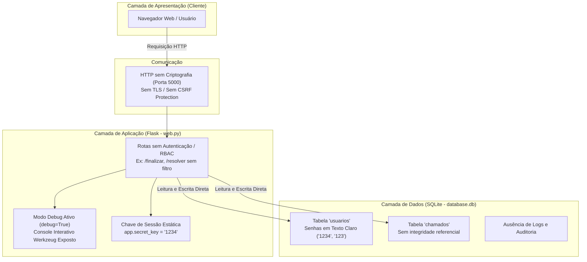

# Arquitetura do Sistema Original (Help Desk Legado)

## 1. Visão Geral da Arquitetura Legada
O sistema original (*sistema-chamados-faculdade*) consistia em uma aplicação web monolítica desenvolvida com Python e Flask, utilizando SQLite como mecanismo de persistência local. A concepção inicial não incorporou práticas de *Security by Design*, resultando em um modelo onde a segurança dependia quase exclusivamente de restrições cosméticas na interface do usuário (HTML/CSS), sem validação mandatória de autorização no backend.

## 2. Diagrama da Arquitetura Legada (Mermaid)

## 3. Componentes e Fragilidades Estruturais

1. **Camada de Apresentação:**
   - Formulários HTML submetidos via requisição `POST` sem tokens de integridade ou sincronização contra ataques de *Cross-Site Request Forgery* (CSRF).
   - Ausência de cabeçalhos HTTP defensivos (*Security Headers*), permitindo ataques de *Clickjacking* e interpretação indevida de tipos MIME.

2. **Camada de Aplicação (`web.py`):**
   - **Chave de Sessão Hardcoded:** A chave de assinatura de cookies estava definida diretamente no código-fonte como `app.secret_key = "1234"`, permitindo que qualquer agente forjasse cookies de sessão de qualquer usuário.
   - **Modo Debug em Execução:** A inicialização com `app.run(debug=True)` expunha o console interativo do depurador Werkzeug, que permite execução remota arbitrária de código (RCE) em caso de exceções não tratadas.
   - **Quebra de Controle de Acesso (Broken Access Control):** Rotas críticas como `/finalizar/<id>` não realizavam verificação de autenticação de sessão, e `/resolver/<id>` não validava o perfil funcional (RBAC), permitindo que usuários comuns assumissem e finalizassem tickets de terceiros.

3. **Camada de Persistência (`database.db`):**
   - **Senhas em Texto Puro:** Senhas de todos os perfis armazenadas em texto claro diretamente na coluna `senha` da tabela `usuarios`, violando o Art. 46 da LGPD e o padrão OWASP ASVS V2.
   - **Inexistência de Trilhas de Auditoria:** Nenhuma tabela de registro de atividades, tornando impossível a responsabilização (*accountability*) ou a reconstrução forense de incidentes.
