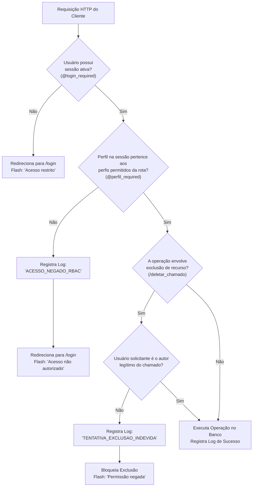

# Controle de Acesso Baseado em Papéis (RBAC) e Menor Privilégio

## 1. Princípio de Projeto
O Sistema WINDOL implementa o modelo **RBAC (Role-Based Access Control)** em conformidade com o padrão **OWASP ASVS Capítulo V4** e a categoria **A01:2021 (Broken Access Control)** do OWASP Top 10. Toda autorização é verificada exclusivamente no servidor (*backend*), garantindo que alterações na interface gráfica não permitam a escalada de privilégios.

## 2. Diagrama de Controle de Acesso (Mermaid)

## 3. Matriz de Permissões por Perfil Funcional

| Rota / Endpoint | Método HTTP | Finalidade Operacional | `usuario` (Solicitante) | `tecnico_n1` | `tecnico_n2` | `tecnico_n3` | `gerente` | `admin` |
| :--- | :---: | :--- | :---: | :---: | :---: | :---: | :---: | :---: |
| `/` | GET, POST | Autenticação no sistema | Sim | Sim | Sim | Sim | Sim | Sim |
| `/logout` | GET | Encerramento de sessão | Sim | Sim | Sim | Sim | Sim | Sim |
| `/alterar_senha` | GET, POST | Alteração da própria senha | Sim | Sim | Sim | Sim | Sim | Sim |
| `/meus_chamados` | GET | Listagem de tickets do autor | **Sim** | Não | Não | Não | Não | Não |
| `/abrir_chamado` | GET, POST | Abertura de novos chamados | **Sim** | Não | Não | Não | Não | Não |
| `/deletar_chamado/<id>` | POST | Cancelamento de chamado próprio | **Sim (Apenas autor)** | Não | Não | Não | Não | Não |
| `/chamados` | GET | Fila de atendimento por nível | Não | **Sim (N1)** | **Sim (N2)** | **Sim (N3)** | Não | **Sim (Todos)** |
| `/resolver/<id>` | GET | Assumir ticket e ver detalhes | Não | **Sim** | **Sim** | **Sim** | Não | **Sim** |
| `/finalizar/<id>` | POST | Concluir com parecer técnico | Não | **Sim** | **Sim** | **Sim** | Não | **Sim** |
| `/encaminhar/<id>` | POST | Escalonar para nível superior | Não | **Sim (p/ N2)** | **Sim (p/ N3)** | Não | Não | **Sim** |
| `/gerente` | GET | Visão de relatórios finalizados | Não | Não | Não | Não | **Sim** | **Sim** |
| `/admin` | GET | Painel geral de administração | Não | Não | Não | Não | Não | **Sim** |
| `/usuarios` | GET | Listagem de usuários do sistema | Não | Não | Não | Não | Não | **Sim** |
| `/criar_usuario` | POST | Cadastro de novos usuários | Não | Não | Não | Não | Não | **Sim** |
| `/editar_usuario/<id>` | GET, POST | Atualização cadastral/perfil | Não | Não | Não | Não | Não | **Sim** |
| `/excluir_usuario/<id>` | POST, GET | Remoção de usuário | Não | Não | Não | Não | Não | **Sim (Exceto si próprio)** |
| `/admin/colaboradores` | GET | Catálogo funcional (LGPD) | Não | Não | Não | Não | Não | **Sim** |
| `/admin/auditoria` | GET | Consulta a logs e rastreabilidade | Não | Não | Não | Não | **Sim** | **Sim** |
| `/privacidade` | GET | Aviso de privacidade LGPD | Sim | Sim | Sim | Sim | Sim | Sim |
