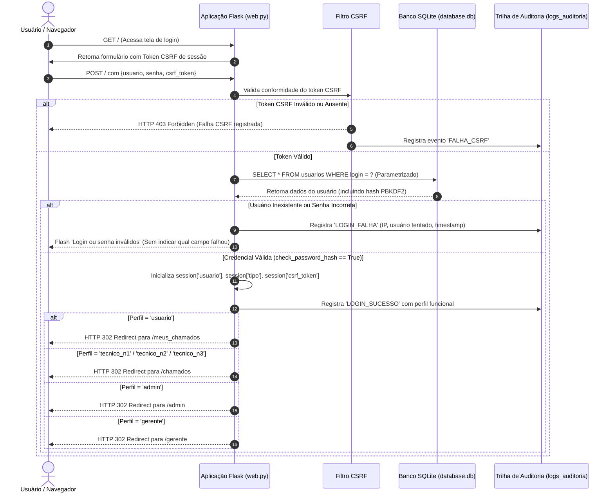

# Fluxo de Autenticação Segura e Gestão de Sessões

## 1. Descrição do Processo
O processo de autenticação do Sistema WINDOL implementa derivação criptográfica adaptativa de chaves (PBKDF2-HMAC-SHA256), proteção contra ataques de força bruta com registro de auditoria, emissão de cookies de sessão assinados com segredo de alta entropia e isolamento de privilégios.

## 2. Diagrama de Sequência de Autenticação (Mermaid)

## 3. Critérios Criptográficos e de Segurança da Sessão
- **Algoritmo:** PBKDF2 com HMAC-SHA256 (Password-Based Key Derivation Function 2);
- **Salt:** 16 bytes pseudo-aleatórios gerados por `os.urandom()` via Werkzeug para cada credencial, garantindo que hashes de senhas idênticas sejam completamente distintos no banco;
- **Iterações:** Padrão Werkzeug 3.x (1.000.000 iterações), oferecendo alta resistência a ataques de força bruta acelerados por GPU;
- **Assinatura de Sessão:** Chave HMAC de 256 bits (`WINDOL_SECRET_KEY`) gerada com entropia criptográfica;
- **Mitigação de Enumeração de Contas:** Em caso de credencial incorreta, o sistema retorna uma mensagem genérica (*"Login ou senha inválidos!"*), sem informar se o erro foi no identificador ou na senha.
