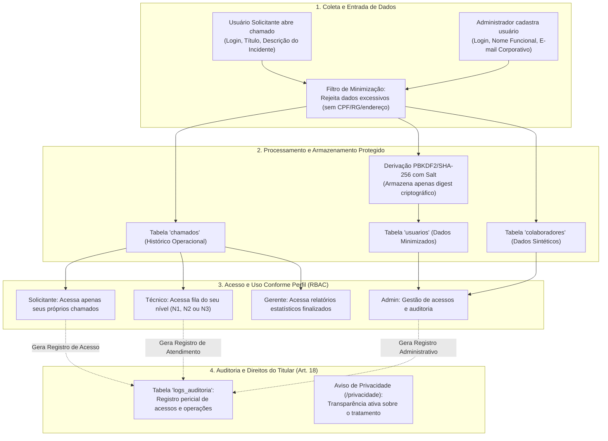

# Fluxo de Tratamento de Dados Pessoais (LGPD)

## 1. Contexto e Enquadramento Legal
O tratamento de dados pessoais no Sistema WINDOL foi estruturado para atender aos requisitos da **Lei nº 13.709/2018 (LGPD)**, com ênfase nos seguintes princípios fundamentais do Artigo 6º:
- **Finalidade (Art. 6º, I):** Tratamento restrito à triagem, resolução de chamados de TI e segurança do ambiente corporativo.
- **Necessidade / Minimização (Art. 6º, III):** Coleta estritamente limitada ao indispensável para a prestação do serviço.
- **Segurança e Prevenção (Art. 6º, VII e VIII):** Salvaguardas criptográficas e controle de acesso para prevenir acessos não autorizados.
- **Responsabilização e Prestação de Contas (Art. 6º, X):** Trilhas de auditoria contínuas para comprovar a eficácia das medidas protetivas.

## 2. Diagrama do Fluxo de Dados e Ciclo de Vida (Mermaid)

## 3. Matriz de Tratamento de Dados por Categoria

| Dado Pessoal Tratado | Categoria do Dado | Base Legal (Art. 7º) | Princípio da Minimização | Medida de Segurança Aplicada |
| :--- | :--- | :--- | :--- | :--- |
| **Login do Usuário** | Dado Cadastral Comum | Execução de Contrato (Inciso V) | Coleta indispensável para identificação unívoca | Indexação com chave única (`UNIQUE`), validação de sessão |
| **Senha de Acesso** | Credencial de Segurança | Execução de Contrato (Inciso V) | Nunca armazenada em texto claro | Hash irreversível PBKDF2:SHA-256 com salt de 16 bytes |
| **Nome Completo** | Dado Cadastral Comum | Legítimo Interesse (Inciso IX) | Limitado ao nome profissional/funcional | Exibição restrita na interface por perfil |
| **E-mail Corporativo** | Dado de Contato | Execução de Contrato (Inciso V) | Apenas domínio corporativo (`@windol.local`) | Sem exposição pública na aplicação |
| **Histórico de Chamados** | Dado Operacional | Execução de Contrato (Inciso V) | Apenas descrições de falhas de hardware/software | Isolamento via SQL parametrizado por solicitante |
| **Endereço IP e Data/Hora** | Registro de Conexão | Cumprimento de Obrigação Legal (Marco Civil, Art. 15) | Coleta automática de metadados de auditoria | Tabela `logs_auditoria` acessível apenas a admin/gerente |
