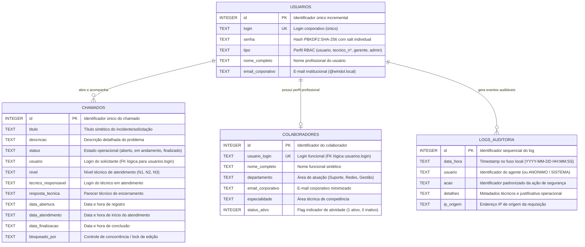

# Modelo Entidade-Relacionamento (DER) e Estrutura de Dados

## 1. Descrição do Modelo de Dados
O banco de dados SQLite (`database.db`) foi modelado para suportar as operações essenciais do Help Desk, incorporando as diretrizes de **minimização de dados pessoais (LGPD Art. 6º, III)** e **trilhas de auditoria imutáveis (LGPD Art. 6º, X)**.

## 2. Diagrama Entidade-Relacionamento (Mermaid)

## 3. Dicionário de Dados e Controles de Proteção

### Tabela `usuarios`
- Armazena credenciais e atributos de identidade funcional.
- A coluna `senha` armazena exclusivamente resumos criptográficos gerados com a função `werkzeug.security.generate_password_hash(method="pbkdf2:sha256", salt_length=16)`.
- Hashes possuem comprimento médio de 108 caracteres, inviabilizando ataques por dicionário ou tabelas rainbow.

### Tabela `colaboradores` (Módulo LGPD)
- Implementada sob o princípio de *Privacy by Design* e minimização.
- Armazena apenas dados públicos-profissionais e técnicos, sem acúmulo de dados sensíveis (sem CPF, RG, filiação, dados bancários ou domiciliares).
- Utilizada para alocação de chamados conforme a competência técnica.

### Tabela `logs_auditoria`
- Componente de governança e não repúdio.
- Permite a investigação de acessos não autorizados (`ACESSO_NEGADO_RBAC`), falhas de login (`LOGIN_FALHA`), criação/exclusão de usuários e manipulação de tickets.
